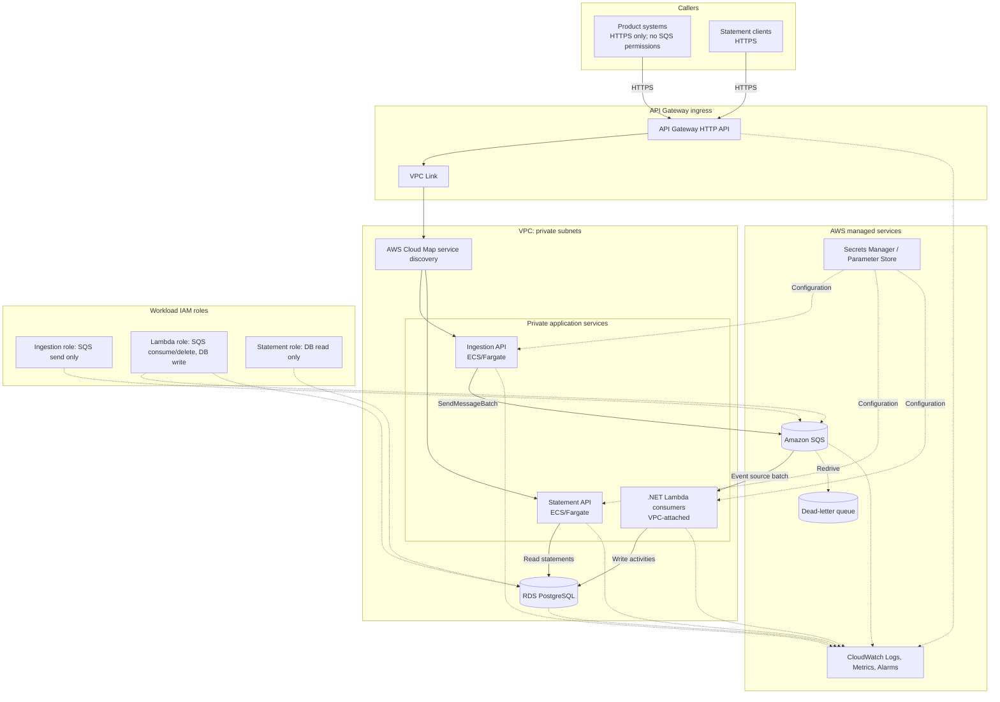

# Solution Notes

## 1. Scope

This repository implements a small activity-ingestion and statement API for SanlamConnect IHub. It deliberately contains no frontend, message queue, AWS deployment, Gridify integration, unit-test project or Docker test dependency. The two business routes are activity ingestion and statement retrieval; the combined health endpoint is operational.

## 2. Assumptions

- **Delivery:** Activities may arrive late or out of order; statement membership is based on occurrence time.
- **Identity:** The upstream system provides a stable source code and external activity ID. Together, they uniquely identify an activity. Source codes are trimmed and uppercased; external IDs remain case-sensitive.
- **Currency:** Callers do not provide currency, and intermediaries do not configure it. All activities and statements use `ZAR`.
- **Intermediary:** The intermediary must already exist. This API does not create or manage intermediary records; activities for unknown IDs are rejected without ingestion.

## 3. Clean Architecture

The solution follows Clean Architecture with dependencies pointing inward: API and Data depend on Application, while Application depends on Domain. Layer names mirror the TopScorers reference; persistence is named `IHub.Data` rather than introducing a separate Infrastructure project.

```text
IHub.Api -> IHub.Services -> IHub.Application -> IHub.Domain
     |                         ^
     +-> IHub.Data ------------+

IHub.IntegrationTests -> IHub.Api (real HTTP host; InMemory EF context)
```

- **Domain:** Activity and Intermediary identity entities plus domain exceptions. It has no ASP.NET Core or EF Core dependency.
- **Application:** Request/response DTOs, `IHubActivityService` contract, repository interfaces and `IUnitOfWork`.
- **Services:** `HubActivityService` implements the Application contract and owns validation, idempotency, business logging and activity outcome instrumentation.
- **Data:** `IHubDbContext`, PostgreSQL mappings, repositories, conflict translation and migrations. This is the persistence implementation boundary.
- **API:** Controllers, `GlobalExceptionHandler`, startup composition, health and OpenTelemetry instrumentation.
- **Integration tests:** xUnit and `WebApplicationFactory` exercise the HTTP application with EF Core InMemory and no repository/service mocks.

Controllers only call Services and translate the result to HTTP status codes. They do not contain business processing or access the DbContext. The statement repository computes aggregates in SQL rather than materializing activities.

## 4. Integration Tests

HTTP integration tests use xUnit, `WebApplicationFactory` and EF Core InMemory. They cover ingestion, idempotency, statement behavior, invalid and unknown-intermediary requests, health and metrics. InMemory is not relational, so PostgreSQL-specific constraints and concurrency still need PostgreSQL-backed verification.

## 5. Data and Persistence

### Repositories and Unit of Work

- `IActivityRepository` persists activities and finds the external identity `(SourceSystem, ExternalActivityId)`.
- `IIntermediaryRepository` checks whether the intermediary identity already exists.
- `IActivityRepository` executes the gross-total aggregate query for a requested intermediary and time window.
- `IUnitOfWork` provides asynchronous `SaveChangesAsync`; the Data implementation translates only a violation of the named activity identity constraint into an application-level domain exception.

An activity is persisted only after its intermediary is confirmed to exist. Intermediary records are managed outside this API; an unknown ID is rejected and no intermediary or activity row is created.

### Activity Data Model

- Each activity stores an internal `Guid`, source system, external activity ID, intermediary ID, occurrence time, amount, and ingestion time. Currency is fixed to ZAR in the application.
- An intermediary row stores only its ID and creation time; it does not configure currency.
- External identity is `(SourceSystem, ExternalActivityId)`. Different sources can reuse the same external ID without being treated as the same activity.
- PostgreSQL stores timestamps as `timestamp with time zone` and amounts as `numeric(18,2)`.

### Constraints and Indexes

- `Activity.Id`: primary key.
- `Activity.SourceSystem` + `Activity.ExternalActivityId`: unique external identity for idempotency.
- `Intermediary.IntermediaryId`: primary key.
- `Activity.IntermediaryId` + `Activity.OccurredAt`: statement-window lookup index.

### Idempotency and Concurrency

The application first checks the composite external identity for the common duplicate path. An identical payload returns the existing activity without a second contribution; a different intermediary, occurrence time or amount returns conflict without overwriting the original. For a new identity, it verifies the intermediary exists, assigns `ZAR`, and inserts the activity through the Unit of Work.

The pre-check is an optimization, not the integrity boundary. If PostgreSQL reports a violation of the composite unique external identity, the Data Unit of Work translates that specific violation. Application reloads the existing row by the composite identity and returns the identical-duplicate outcome or a conflict. Other database errors are not mislabeled as duplicates. The database unique constraint prevents concurrent requests from both contributing.

Intermediary records are managed outside the ingestion service. PostgreSQL's foreign key remains the persistence-level relationship guard; the application checks for the intermediary before attempting an insert.

### Out-of-Order Activities

Statement membership uses `OccurredAt`, never arrival order or `IngestedAt`. A late activity whose occurrence is inside a historical window is included there. No running total or precomputed statement is maintained, so inserting late data does not require repairing stored aggregates.

### Statement Query

`ActivityRepository` filters by intermediary and the half-open occurrence-time interval `[start, end)`, then computes `GrossTotal` with a database `SUM` without materializing activities. Empty totals are zero.

## 6. API Contracts

### `POST /activities`

Request fields: `sourceSystem`, `externalActivityId`, `intermediaryId`, `occurredAt`, `amount`. There is no currency request field.

- New persisted activity: `201 Created` with the activity response.
- Identical duplicate: `200 OK` with the existing activity response.
- Conflicting duplicate: `409 Conflict` ProblemDetails.
- Unknown intermediary: `404 Not Found` ProblemDetails; the activity is not ingested.
- Invalid data: `400 Bad Request` ProblemDetails.
- Unexpected failure: generic `500` ProblemDetails without exception details.

`GlobalExceptionHandler` maps domain validation exceptions to `400`, unknown intermediaries to `404`, identity conflicts to `409`, and unexpected exceptions to a sanitized `500` response. It logs the exception with the request trace ID and includes that ID in ProblemDetails.

### `GET /intermediaries/{intermediaryId}/statement?start=...&end=...`

Returns intermediary ID, currency, requested start/end and gross total. Start must be less than end. Statement membership uses the half-open occurrence-time interval documented above.

## 7. Observability

Serilog writes structured JSON logs for application events, exceptions, and completed requests (trace ID, method, path, status, and duration). Request bodies and financial payloads are excluded. The global exception handler returns sanitized ProblemDetails; the OTLP log sink is commented out.

OpenTelemetry collects ASP.NET Core request traces and HTTP request metrics. Monitor request volume, duration/latency and response status codes (especially `4xx` and `5xx`) using the built-in HTTP metrics and their method/route/status dimensions. No separate application-level HTTP-error, conflict or ingestion-failure counters are emitted.

Application-specific metrics:

- `ihub.activities.accepted`: accepted activities; monitor ingestion throughput.
- `ihub.activities.duplicates`: identical duplicate submissions; use alongside accepted counts to understand retry volume.

`GET /metrics` exposes metrics through Prometheus. OTLP trace export and CloudWatch are not configured; the Prometheus exporter is prerelease. `GET /health` reports PostgreSQL connectivity as sanitized `healthy` (200) or `unhealthy` (503).

## 8. Trade-offs and Next Steps

- `IHub.Data` intentionally follows the reference repository's layer naming; it owns the same persistence responsibilities commonly named Infrastructure.
- Serilog writes structured JSON logs to the console. Commented OTLP configuration shows how logs and metrics can be sent to an OpenTelemetry Collector; enabling metrics export requires the commented OTLP exporter package reference in `IHub.Api.csproj`. CloudWatch delivery remains a Collector deployment concern: configure its AWS credentials/permissions and pipelines to export logs to CloudWatch Logs and metrics to CloudWatch. Metrics are also exposed through Prometheus. Traces are instrumented but not exported.
- The current `IUnitOfWork` persists through EF `SaveChangesAsync`; intermediary records are managed outside this API and are only checked during ingestion.
- The single initial migration is suitable for a fresh local database. Production schema evolution should use reviewed incremental EF migrations and apply them as a single deployment task before rolling out dependent code.
- Add PostgreSQL-backed integration tests and query-plan inspection when a disposable or managed PostgreSQL environment is available.
- Gridify is a possible future enhancement if clients later need controlled filtering, sorting or pagination. The current statement API intentionally supports only one intermediary and one time window.
- A queued ingestion workflow with SQS and Lambda remains a proposal; it is not installed or implemented here.

## 9. Proposed AWS Architecture and Alerts (Design Only)



A standard SQS queue is a good fit when event ordering is not required: statements use event occurrence time, and the database identity makes retries idempotent. The queue absorbs bursts, separates upstream availability from database write capacity, buffers work during short RDS interruptions and lets Lambda concurrency be controlled independently. If strict per-key delivery ordering becomes a real requirement, evaluate FIFO queues and their throughput/deduplication trade-offs instead.

Upstream systems call only the HTTPS Ingestion API; they do not publish to SQS directly. The separately deployed Statement API serves statement reads. The Ingestion API validates requests, enqueues activity messages, and returns `202 Accepted`; Lambda consumers use the same Application ingestion use case and Data persistence boundary rather than duplicating business rules. The current local API combines both routes and persists `POST /activities` synchronously with `201`/`200`, so this separation and asynchronous contract are future changes.

A future `POST /activities/batch` could accept a bounded list of activities while preserving per-activity idempotency. The Ingestion API publishes each activity as an SQS message, using `SendMessageBatch` for up to 10 messages per call. Lambda's SQS event source mapping can deliver configurable batches; process records independently and report partial batch failures so only failed records retry. Tune batch size to RDS capacity. Bulk submission and Lambda batching are not implemented in the current API.

SQS and Lambda provide at-least-once delivery, not exactly-once processing. Delete a message only after the database commit. The `(SourceSystem, ExternalActivityId)` constraint remains the final idempotency guard when a Lambda succeeds in PostgreSQL but fails before deleting the message. Set the visibility timeout above the Lambda's maximum useful processing time and bound Lambda reserved concurrency to the RDS connection budget (consider RDS Proxy if justified).

Classify failures deliberately: transient database/network errors should be retried with bounded backoff; permanent payload/schema failures should be surfaced and moved to a DLQ rather than retried indefinitely. Configure a redrive policy after a small number of receives (for example, five), alarm on DLQ depth and oldest-message age, retain diagnostic metadata without logging secrets, and provide an operator-reviewed redrive path after correcting the underlying issue. Avoid automatically replaying a whole DLQ without checking whether the defect is fixed.

Use RDS PostgreSQL in private subnets, API Gateway HTTP API with VPC Link and AWS Cloud Map private integrations to separate ECS/Fargate Ingestion and Statement APIs, and Lambda for queued ingestion. Keep the services private; API Gateway routes HTTPS requests to each service. Store credentials in Secrets Manager or Parameter Store, rotate them, and grant each workload least-privilege access. Only the Ingestion API role can send to SQS; upstream systems have HTTPS access only. Use CloudWatch Logs for centralized logs and CloudWatch Alarms on CloudWatch Metrics for alerting. Scale each API independently and limit Lambda concurrency to preserve RDS headroom; queue age is a better signal of unmet ingestion demand than Lambda concurrency alone.

For production schema changes, run one controlled migration task in the deployment pipeline before rolling out code that requires the new schema. Use additive/backward-compatible changes first, deploy consumers that tolerate old and new messages during rollout, then remove obsolete schema only after old tasks are gone. Keep a rollback plan for application versions; database rollback is not always safe after new data has been written, so prefer a forward-fix for destructive migrations.

### AWS Alerts

These are initial suggestions and should be tuned to production baselines:

1. **Elevated ingestion/request errors:** alarm when the 5-minute error ratio exceeds 5% with at least 100 requests. Inspect logs by request ID and outcome; check RDS connectivity, validation/conflict rates and recent deployments.
2. **Queue age / processing delay:** in a queued design, alarm when SQS `ApproximateAgeOfOldestMessage` exceeds 5 minutes for 10 minutes. Check Lambda throttles, database capacity, retries and DLQ volume; scale consumers only within the RDS connection budget.

## 10. AI Assistance

GitHub Copilot was used to assist with repository analysis, implementation, integration-test changes and documentation drafting. The recorded build and test claims in these files refer to commands run locally; no AWS deployment, PostgreSQL-backed concurrency test or external review is claimed.
